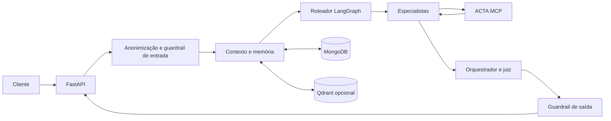

# 🤖 ACTA AI

Assistente gerencial do ACTA para apoiar o ciclo **PDCA** (*Plan, Do, Check, Act*), consultar dados autorizados dos ciclos e manter conversas, memórias e skills pessoais.

## 📌 Visão geral

O `acta-ai` recebe mensagens por uma API HTTP, executa um fluxo de agentes com LangGraph e consulta operações de domínio pelo [servidor ACTA MCP](https://github.com/AppActa/acta-mcp). Ele também mantém histórico de conversas, memórias e skills pessoais no MongoDB; o Qdrant pode indexar esses dados para busca semântica.

O roteador direciona cada solicitação a especialistas de ciclos, tarefas, colaboradores, formulários, indicadores, relatórios, lições aprendidas ou FAQ. Um orquestrador consolida os resultados, e o juiz verifica se a resposta está apoiada pelas evidências recebidas antes da revisão de saída.

## ✨ Funcionalidades

| Domínio | Capacidades |
| --- | --- |
| Conversas | Criar sessões, processar mensagens e consultar histórico; a primeira mensagem é que persiste a sessão. |
| Especialistas | Roteamento para consultas de ciclos, tarefas, colaboradores, formulários, indicadores, relatórios, lições aprendidas e FAQ via ACTA MCP. |
| Ciclos | Encontrar ciclos pela descrição e consultar um ou vários ciclos, mantendo chamadas MCP dentro do escopo informado. |
| Áudio | Transcrever arquivos de até 25 MB e encaminhar o texto ao fluxo de chat. |
| Conversas | Persistir sessões e mensagens no MongoDB, carregar até 30 mensagens recentes e indexar mensagens no Qdrant. |
| Skills pessoais | Criar skills em Markdown pelo chat ou pela API, listar e excluir skills e invocá-las com comandos como `/nome-da-skill sua pergunta`. |
| Proteção da interação | Reconhecer padrões de prompt injection e dados pessoais; avaliar fidelidade, segurança e relevância da resposta antes de devolvê-la. |

## 🏗️ Arquitetura e segurança



As conversas e memórias canônicas ficam no MongoDB. Quando Qdrant e a chave Gemini estão configurados, embeddings apoiam a busca semântica; sem esse índice, a recuperação usa mensagens recentes do MongoDB. O histórico de execução do LangGraph fica em memória de processo e não substitui a persistência das conversas.

As rotas HTTP recebem `usuario_id` e `empresa_id` no corpo ou na query e usam esses valores para criar o contexto da requisição. Este repositório não implementa autenticação HTTP nas rotas FastAPI. Em produção, exponha a API atrás de um gateway ou serviço que autentique o chamador e derive os identificadores da identidade verificada; não aceite esses IDs diretamente de clientes não confiáveis. Nas chamadas de domínio, o ACTA MCP recebe os identificadores nos cabeçalhos e valida perfil, empresa e acesso ao ciclo.

## 🛠️ Tecnologias

| Tecnologia | Uso |
| --- | --- |
| Python 3.11+ | Versão mínima declarada; o contêiner e a CI usam Python 3.14. |
| FastAPI 0.141.1 | API HTTP e documentação OpenAPI; versão resolvida em `uv.lock`. |
| LangGraph 1.2.11 | Fluxo de roteamento, especialistas, orquestração e juiz. |
| OpenAI 2.54.0 | Modelos de chat e transcrição de áudio. |
| MCP SDK 1.28.1 | Cliente do servidor de ferramentas ACTA MCP. |
| MongoDB / PyMongo 4.17.0 | Conversas, mensagens, memórias e skills pessoais. |
| Qdrant | Índice semântico opcional para mensagens e memórias. |
| Gemini | Embeddings usados na busca semântica de memória. |
| JEV | Classificação de segurança e avaliação da resposta final. |
| uv 0.12.0 | Sincronização de dependências e validação na CI. |

As versões de bibliotecas são as resolvidas no arquivo [`uv.lock`](uv.lock). A versão do servidor MongoDB depende do ambiente e não é fixada por este repositório.

## ✅ Pré-requisitos e configuração

Para executar localmente, tenha Python 3.11 ou superior, [uv](https://docs.astral.sh/uv/), um MongoDB acessível e um servidor [ACTA MCP](https://github.com/AppActa/acta-mcp) acessível. O fluxo de conversa também requer credenciais válidas para OpenAI e JEV. Gemini e Qdrant são usados para busca semântica de memória.

Crie um arquivo `.env` local a partir do exemplo e substitua os valores de demonstração por credenciais do seu ambiente:

```powershell
Copy-Item .env.example .env
```

| Configuração | Finalidade |
| --- | --- |
| `OPENAI_API_KEY` | Modelo de chat e transcrição de áudio. |
| `JEV_API_KEY` | Guardrails de entrada e saída e avaliação da resposta. |
| `ACTA_MCP_URL`, `ACTA_MCP_API_KEY` | Endpoint e credencial de serviço do ACTA MCP. O endpoint padrão é `http://127.0.0.1:8000/mcp`. |
| `MONGODB_URI` | Banco de conversas e memórias; o padrão local é `mongodb://127.0.0.1:27018`. |
| `GEMINI_API_KEY`, `QDRANT_CLUSTER_ENDPOINT`, `QDRANT_API_KEY` | Configuração da busca semântica em mensagens. Sem Qdrant, o contexto usa as mensagens recentes do MongoDB. |
| `ACTA_OPENAI_MODEL`, `ACTA_OPENAI_TRANSCRIPTION_MODEL` | Modelos usados; padrões `gpt-6-luna` e `gpt-transcribe`. |

A lista completa de parâmetros e valores padrão está em [Configuração](docs/configuracao.md). Nunca versione o `.env` real.

## 🚀 Execução local

Com MongoDB e ACTA MCP disponíveis e o `.env` preenchido, instale as dependências e inicie a API:

```powershell
uv sync --extra dev
uv run uvicorn main:app --reload --host 127.0.0.1 --port 8200
```

O serviço local fica em `http://127.0.0.1:8200`. Consulte `GET /health` para verificar se a API está ativa e `/docs` para abrir a documentação interativa. O health check confirma apenas que a API respondeu; ele não verifica os serviços externos.

O endpoint padrão do ACTA MCP é `http://127.0.0.1:8000/mcp`. Ajuste `ACTA_MCP_URL` quando o MCP estiver em outro endereço. Para chamadas feitas fora de uma rota HTTP, configure também `ACTA_MCP_USUARIO_ID` e `ACTA_MCP_EMPRESA_ID`.

### Docker

Construa e inicie o contêiner:

```powershell
docker build -t acta-ai .
docker run --env-file .env -p 8200:8200 acta-ai
```

Dentro do contêiner, `127.0.0.1` aponta para o próprio contêiner. Configure `MONGODB_URI` e `ACTA_MCP_URL` com endereços alcançáveis pela rede do contêiner.

## 🔌 API HTTP

As rotas principais são:

| Rota | Uso |
| --- | --- |
| `GET /health` | Verifica se a API está ativa. |
| `POST /nova_conversa` | Gera um `session_id`; a sessão passa a ser persistida após a primeira mensagem. |
| `POST /chat` | Processa uma mensagem e retorna a resposta para o `session_id`. |
| `POST /chat/audio` | Transcreve áudio e encaminha o texto ao fluxo de chat. |
| `GET /listar_chats`, `GET /chats/{session_id}/mensagens` | Lista conversas e mensagens pertencentes ao usuário e à empresa informados. |
| `/skills` | Cria, lista e exclui skills pessoais. |

A API completa, parâmetros e exemplos de requisição estão em [Referência da API HTTP](docs/api.md). A persistência e o contexto de conversas estão em [Histórico de conversas](docs/memoria.md).

## 🧪 Validação e fluxo de entrega

A CI executa o `make validate` em pull requests e em pushes para `main`. O alvo sincroniza o lockfile, verifica o lint com Ruff e executa a suíte Pytest com cobertura mínima configurada de 80%. A CI usa Python 3.14.

Para executar a mesma validação localmente:

```powershell
make validate
```

O [`render.yaml`](render.yaml) descreve um serviço web Docker no Render. O arquivo configura `autoDeploy: false`; a implantação deve ser iniciada conforme o processo definido no ambiente.

## 📁 Estrutura

```text
.
├── .github/workflows/  # validação contínua
├── agents/             # roteador, especialistas, guardrails e juiz
├── clients/            # clientes MCP, memória, skills e transcrição
├── db_scripts/         # conexão, índices e inicialização MongoDB
├── docs/               # arquitetura, API, configuração e memória
├── tools/              # operações de domínio expostas aos agentes
├── main.py             # aplicação FastAPI e rotas HTTP
├── pipeline.py         # grafo LangGraph e execução do chat
├── config.py           # leitura de variáveis de ambiente
├── pyproject.toml
└── README.md
```

## 📚 Documentação

- [Arquitetura e fluxo da conversa](docs/arquitetura.md)
- [Referência da API HTTP](docs/api.md)
- [Histórico de conversas](docs/memoria.md)
- [Configuração, execução e testes](docs/configuracao.md)
- [ACTA MCP](https://github.com/AppActa/acta-mcp)

## 🤝 Links e autoria

- [Repositório](https://github.com/AppActa/acta-ai) · [Licença MIT](LICENSE) · `acta.institutojef@gmail.com`
- Contribuições: use *issues* e *pull requests*; há um [`PULL_REQUEST_TEMPLATE.md`](PULL_REQUEST_TEMPLATE.md).
- Autoria: Equipe ACTA.
