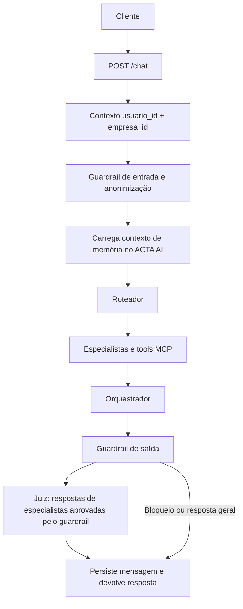

# Arquitetura do ACTA AI

## Responsabilidades

O ACTA AI é a camada conversacional e mantém suas capacidades internas: memória e
skills pessoais. Para dados, FAQ e operações dos domínios ACTA, chama tools
publicadas pelo MCP, que aplica autorização e isolamento de tenant.

| Componente | Responsabilidade |
| --- | --- |
| `main.py` | API FastAPI, validação dos contratos HTTP e contexto da requisição. |
| `pipeline.py` | Grafo LangGraph e histórico em memória de processo por sessão. |
| `agents/estado.py` | Nós do fluxo, roteamento, especialistas, memória e avaliação. |
| `agents/guardrail.py` | Anonimização de PII e bloqueios de segurança. |
| `clients/mcp_acta_client.py` | Cliente Streamable HTTP para operações de domínio. |
| `clients/memory_client.py` | Operações de memória no MongoDB/Qdrant do ACTA AI. |
| `clients/skill_client.py` | Skills pessoais no MongoDB do ACTA AI. |
| `utils/` | Repositórios e serviços internos do chatbot. |

## Fluxo de uma mensagem

O roteador seleciona os especialistas de acordo com a intenção. Especialistas usam
tools do MCP para dados de ciclos, tarefas, colaboradores, formulários, predições e
lições aprendidas e FAQ. O FAQ/RAG usa a base documental publicada pelo MCP. A resposta final passa
por revisão antes de voltar ao cliente.

O guardrail de saída revisa e remove dados pessoais antes do juiz. Somente respostas
de especialistas aprovadas pelo guardrail seguem para avaliação de fidelidade.
Bloqueios e respostas gerais encerram após o guardrail. A persistência registra
apenas a resposta final entregue, incluindo eventuais substituições feitas pelo juiz.

## Intenções de transação

Consultas continuam no fluxo existente. Somente ferramentas que alteram dados
passam pelo gate de intenção antes do MCP: `{"tool": "nome", "argumentos": {}}`.
O juiz recebe a proposta normalizada, pedido, contexto e evidências. Apenas
`aprovada` com apoio >= 0.7 permite execução. `corrigir_proposta` devolve o motivo
ao especialista, com até duas correções além da proposta inicial.
`pedir_esclarecimento` devolve a pergunta ao usuário. Saída inválida, contraditória
ou falha do juiz bloqueia a proposta.

O gate fica no cliente MCP para cobrir também chamadas diretas. Escritas não usam
cache nem retry automático de transporte. Lotes com escrita são bloqueados antes
do despacho; os especialistas executam em sequência para encerrar novas ações
quando houver esclarecimento ou bloqueio. A autorização efetiva continua no MCP;
não há rollback de operações anteriores já concluídas.

## Correção da resposta final

Se a avaliação final JEV reprovar o rascunho, uma saída estruturada determina o
encaminhamento: repetir o especialista responsável quando faltam evidências ou
sua análise está errada; reformular somente o orquestrador quando os dados e as
respostas dos especialistas estão corretos; ou perguntar ao usuário quando falta
informação que depende dele. Esse encaminhamento não pode aprovar a resposta.

Na avaliação, as respostas dos especialistas levam somente nome e texto; os
resultados completos das ferramentas ficam na lista central de evidências, uma
vez por resultado distinto. Isso evita enviar cópias aninhadas do mesmo resultado
e exceder o limite de contexto do juiz, preservando os fatos retornados.

São permitidas até duas correções por rodada, separadas das correções de intenção.
Cada novo rascunho passa pelo guardrail e pelo JEV novamente. Somente a resposta
final entregue é persistida. As revisões usam cache de consultas novo e não podem
executar escritas, mesmo que um agente tente repeti-las. Resultados confirmados de
escritas são preservados; uma nova consulta substitui o resultado anterior da
mesma consulta. Falhas do juiz, saída inválida ou limite esgotado encerram com a
mensagem segura. Uma pergunta de esclarecimento passa pelo guardrail e encerra
a rodada, aguardando nova mensagem do usuário.

## Identidade e isolamento

Cada rota autenticada instala um `mcp_request_context` com `usuario_id`, `empresa_id`
e um `trace_id`. O contexto filtra memória/skills no ACTA AI e vai em cabeçalhos nas
chamadas MCP; a identidade não fica disponível como argumento do modelo.

O cache de tools dura somente uma execução da pipeline. O estado do LangGraph usa
uma chave que inclui empresa, usuário e `session_id`, evitando misturar históricos
locais de sessões de tenants diferentes.

## Histórico local e memória persistente

O `MemorySaver` do LangGraph conserva mensagens enquanto o processo está vivo.
Ele melhora a continuidade da rodada, mas não é a fonte persistente. A memória
durável fica no ACTA AI: MongoDB é a fonte oficial e Qdrant, quando configurado, é o
índice semântico.
Consulte [Memória](memoria.md) para o ciclo completo.
